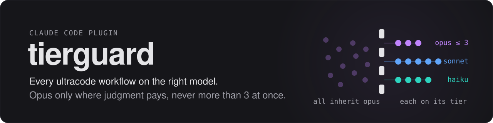
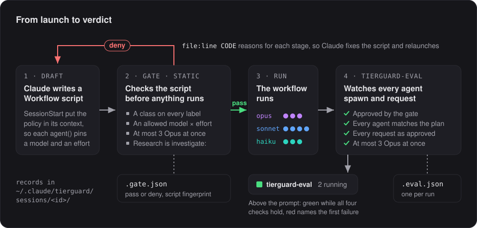
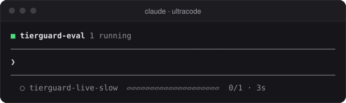
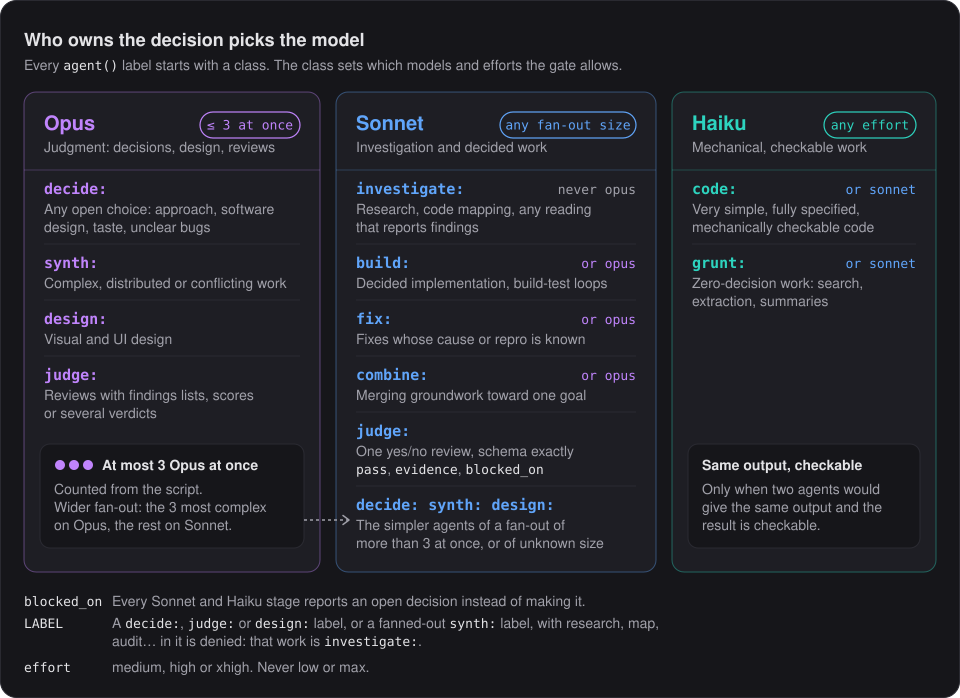
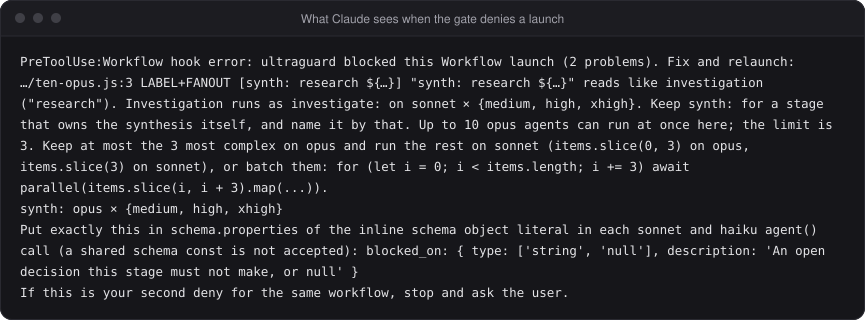
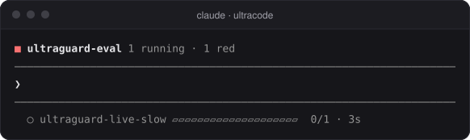

<p align="center">
  
</p>

<p align="center">
  A Claude Code plugin that keeps ultracode workflows from running every subagent on Opus.
</p>

<p align="center">
  <a href="https://github.com/GonzMenSeb/ultraguard/actions/workflows/ci.yml"></a>
  
  
  
  <a href="LICENSE"></a>
</p>

## The problem

With ultracode on, your session runs Opus 5.5 or Fable. A workflow fans out to many subagents, and each one inherits the session's model and effort unless its stage pins them. So a single multi-step task can start a dozen top-tier agents, most of them doing work a cheaper model handles just as well.

Pinning models is not enough on its own. In this project's own history, a workflow launched 10 research agents at once, all on Opus: six web-research and four code-mapping agents, every one labeled `synth:`. The label claimed synthesis. The work was reading.

## What ultraguard does

<p align="center">
  
</p>

1. **At session start** it gives Claude the delegation policy, so Claude writes compliant workflow scripts the first time.
2. **Before launch** a gate reads the workflow script and denies it if any `agent()` call breaks the policy. It never runs the script and makes no model call.
3. **During the run** ultraguard-eval watches the agents the workflow spawns and shows, above the prompt, whether the run matches what the gate approved.

Every gate decision and every run is written to a small JSON file, so you can check afterwards what happened.

## Install

In Claude Code:

```
/plugin marketplace add GonzMenSeb/ultraguard
/plugin install ultraguard@ultraguard
```

The marketplace and the plugin are both named `ultraguard`. Start a new session afterwards so the policy loads at session start.

Two things people trip on:

- **Node 18 or later must be on `PATH`.** The hooks run with whatever `node` is found there.
- **`dontAsk` mode refuses every launch** unless `permissions.allow` has a `Workflow` entry. ultraguard never allows a launch itself; it only denies. ultraguard warns you at session start when your settings files set `dontAsk` without a `Workflow` allow rule. Details are in the [reference](docs/reference.md).

The gate needs Claude Code 2.1.295 or later. ultraguard is pinned to and live-tested on 2.1.319.

### See it work

1. Turn on ultracode: `/effort ultracode`.
2. Give Claude a multi-step task, or ask it outright to use a workflow.
3. When Claude launches the workflow, a `□ ultraguard-eval` row appears above the prompt. Green means the run matches what the gate approved.

Claude Code shows only one plugin row above the prompt. If another plugin draws there (Cognee's memory row does), ultraguard's row is hidden: turn that plugin's row off, or run `/ultraguard` to open the pane directly.

<p align="center">
  
</p>

## The rules

### Who owns the decision picks the model

<p align="center">
  
</p>

Every `agent()` call carries a label that starts with a class, such as `decide:` or `build:`, and pins a model and an effort. The class says who owns the decision, and the class decides which models are allowed:

- `decide:`, `judge:`, `synth:` and `design:` own open choices, reviews, synthesis and design. They run on Opus.
- `investigate:` reads and reports findings. It runs on Sonnet only.
- `build:`, `fix:` and `combine:` carry out work whose design is already decided. They run on Sonnet or Opus.
- `code:` and `grunt:` do fully specified, fixed-shape work with nothing to decide: a table, a count, an extraction or a check over named inputs. They run on Sonnet, or on Haiku at `medium`, `high` or `xhigh`, and Haiku `medium` is the default.

Opus is spent where a wrong call is expensive. Everything else goes to the cheapest model that does the job as well.

### Each rule and the waste it prevents

| Rule | Waste it prevents |
|---|---|
| Every agent pins a model and an effort. | Agents silently inheriting the session's Opus or Fable. |
| At most 3 Opus agents run at once in a workflow. The gate counts them from the script; if it cannot count, it denies. | The 10-Opus fan-out. |
| Investigation is `investigate:`, on Sonnet only. A `decide:`, `judge:` or `design:` label, or a fanned-out `synth:` label, that contains a word like research, map, explore, search, find or audit is denied. | Research dressed up as `decide:` or `synth:` to get Opus. |
| `judge:` may run on Sonnet for one yes/no review, with a `pass`, `evidence`, `blocked_on` schema. | Opus spent on checks a cheaper model answers just as well. Findings lists and scores stay on Opus. |
| `decide:`, `synth:` and `design:` may run on Sonnet for the simpler agents of a fan-out of more than 3. | Paying Opus for the long tail of a big fan-out, while the hardest items stay on Opus. |
| Haiku only for `code:` and `grunt:`, at `medium`, `high` or `xhigh`. | Cheap output that has to be redone. Haiku gets work where two agents would produce the same result and a script can check it; a replay of five fixed-shape tasks matched the recorded answer on all 30 Haiku runs, at 6 to 11 times less cost than Sonnet (see the [Haiku evidence](docs/reference.md#haiku-evidence)). Discovery, review and anything that weighs evidence stay on Sonnet or Opus. |
| Every Sonnet and Haiku agent has a `blocked_on` field in its output schema. | A cheaper agent making a decision it does not own. It reports the open question instead, and Claude re-runs that stage as `decide:`. |
| Efforts are `medium`, `high` or `xhigh`: never `low`, never `max`. Models are `opus`, `sonnet` and `haiku`: never Fable or Mythos as an agent model. | `max` burning tokens on stages that do not need it, `low` producing work that gets redone, and workers on the most expensive models. |
| No agent uses a model above the session's. A Fable session counts as Opus. | A workflow reaching past the model you chose for the session. |

The fix the gate suggests when a fan-out has too many Opus agents: keep the 3 most complex on Opus and run the rest on Sonnet.

```js
await parallel([
  ...ranked.slice(0, 3).map(q => () => agent(`Design the answer to: ${q.summary}`, {
    label: `design: ${q.key}`, model: 'opus', effort: 'high'
  })),
  ...ranked.slice(3).map(q => () => agent(`Design the answer to: ${q.summary}`, {
    label: `design: ${q.key}`, model: 'sonnet', effort: 'high',
    schema: {
      type: 'object',
      properties: {
        design: { type: 'string' },
        blocked_on: { type: ['string', 'null'], description: 'An open decision this stage must not make, or null' }
      },
      required: ['design', 'blocked_on']
    }
  }))
])
```

For Opus work over a list whose size is only known at run time, the alternative is a loop that runs 3 at a time. The full rules, the deny codes and how the gate counts concurrency are in the [reference](docs/reference.md).

## When the gate says no

<p align="center">
  
</p>

The deny shows in your terminal, and its reason goes to Claude. Each line names the script line, a code such as `FANOUT` or `LABEL` and what is wrong. The reason then lists the allowed models and efforts for each failing class, and, for a label that reads like investigation, says that a fixed list, table or count over named inputs is `grunt:`. Claude reads it, fixes the script and launches again. The reason ends with "If this is your second deny for the same workflow, stop and ask the user," so a second deny turns into a question for you rather than a loop. Problems only you can fix, such as an environment variable that overrides the pinned model, are flagged so Claude tells you instead of relaunching.

## Know it was enforced

A passing gate prints nothing. ultraguard-eval is how you see that the rules held. It uses no model; it runs four checks on each running workflow:

1. **Approved by the gate.** The gate passed this launch, and the script that ran is the exact script the gate read.
2. **Every agent matches the plan.** Each agent's label matches a stage the gate approved, and it runs on that stage's model.
3. **Every request as approved.** Each request an agent sends uses the approved model and exactly the approved effort.
4. **At most 3 Opus at once.** The Opus agents running in the workflow never exceed the limit.

A run is green while all four hold. Otherwise it turns red and names the first failure.

<p align="center">
  
</p>

Select the row, or run `/ultraguard`, to open the pane: one row per workflow, running ones first and ended ones under "finished this session". Enter opens a workflow: the four checks with ✓ or ✗, then its phases. Each phase is a block you can fold (Enter, or `a` for all) with the saved figure next to its title, and, while folded, the models that ran in it; open, it lists its agents with a ✓ or ✗, what each saved and the model and effort it ran on. A workflow without phases shows the agents in one flat table. The focused row is drawn inside a rounded outline.

<p align="center">
  
</p>

Both parts leave a record in `~/.claude/ultraguard/sessions/<session_id>/` (or under `CLAUDE_CONFIG_DIR`): `<tool_use_id>.gate.json` for each gate decision, pass or deny, and `<tool_use_id>.eval.json` for each run ultraguard-eval saw.

If a workflow is running, there is no ultraguard-eval row and `/ultraguard` is not a command, ultraguard is not loaded in that session.

### See what it saved

For each tracked run, ultraguard shows what it saved against running every agent of the workflow on your session's model at your session's effort. That is what Claude Code does when a stage pins nothing. Open a run in the pane to see the "ultraguard saved" block, one bar per row:

- **Context:** how full the session's context window is, as a status line shows it. Right after a fresh session or a compaction it shows an empty bar and a dash until the next response.
- **On a subscription:** a 5-hour and a weekly bar. The used part is plain, the saving is colored, darker meaning more saved, and `+1.4 ±0.6` is the percent of the limit saved, in the percentages `/usage` shows. A mark at the end of the bar is 100 percent of the limit.
- **On an API key:** a cost bar with the dollars spent and the dollars saved at API prices.
- **Limit messages:** under the bars, when the saving mattered: without ultraguard you would have passed your 5-hour limit, come within 10 points of it, or passed half of it. A small saving is hedged with "likely" or "might".
- **Money and tokens:** on a subscription, the dollars saved at API prices, then how many fewer tokens the agents used, each on its own line. It can read "more tokens" when the cheaper model read and wrote more at a lower price per token.

Each `±` is how far off the estimate can be, 9 times out of 10. The token figure is the median, with no `±`. A figure ultraguard cannot back is shown as unknown, never as 0. When something is off, such as agents left out of the estimate or ratios from published figures, a dim line says so.

The bar shows the limit use as it was at the last estimate, not live. The deep purple of the largest savings is hard to read on dark terminals.

Limit figures need 5 readings. ultraguard learns how fast your own limit fills from the `/usage` percentages as you work, and until a window has 5 readings the pane says "learning how fast your limit fills, 3 of 5 readings so far".

The ratios between models come from 22 replayed agents. The replays measured two transitions: Sonnet at high against Opus at high, and Sonnet at high against Opus at medium. Other efforts of the same model are chained from those with published effort steps, and every other pair, the same model at another effort included, uses published figures. The pane says which, and the `±` is wide for published figures. The results table is in the [reference](docs/reference.md#calibration-results).

## Tuning

The policy is one file, [`policy/default.json`](policy/default.json):

- `classes`: what each class owns and its allowed model and effort pairs, plus `fanoutPairs` and `verdictPairs` for the Sonnet exceptions.
- `limits`: `maxConcurrentOpus` (3) and `bigFanout` (3).
- `labelCheck`: the words that mark a label as investigation, and the classes they apply to.

To change it, edit the file in your own copy, bump the patch version in `package.json`, `.claude-plugin/plugin.json` and `.claude-plugin/marketplace.json`, and run `npm test`. A broken policy blocks every launch. The [reference](docs/reference.md) describes every key.

## Limits

- Whether a label is honest is only partly enforceable. The word check catches the common case; a misleading label without those words passes.
- Only `Workflow` launches are gated. Agent tool calls are not.
- The threat model is a cooperative Claude writing workflow scripts. ultraguard is not a sandbox, and deliberate evasion is out of scope.
- ultraguard-eval observes and reports. It never stops a running workflow.

The full list is in the [reference](docs/reference.md).

## Development

```
npm test
```

Tests run on Node 18 with `node:test`, which is also the CI runtime. There are no dependencies; acorn is vendored in `vendor/acorn.mjs`. The ultraguard-eval module is checked with `claude plugin validate .` and `claude plugin test .`. To try a working copy, start Claude Code with `claude --plugin-dir <path-to-this-repo>`.

## Credits and license

ultraguard is a fork of [danielkremen818/ultracost](https://github.com/danielkremen818/ultracost). The engine was rewritten; the hook wiring pattern, test discipline and attribution were kept. It includes acorn 8.19.0 (MIT).

MIT. See [`LICENSE`](LICENSE) and [`NOTICE`](NOTICE).
