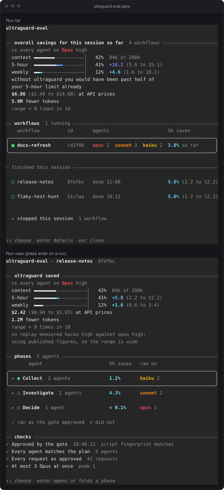

<p align="center">
  
</p>

<p align="center">
  A Claude Code plugin that keeps ultracode workflows from running every subagent on Opus.
</p>

<p align="center">
  <a href="https://github.com/GonzMenSeb/ultraguard/actions/workflows/ci.yml"></a>
  
  
  
  <a href="LICENSE"></a>
</p>

## The problem

With ultracode on, your session runs a top-tier model such as Opus or Fable. A workflow fans out to many subagents, and each one inherits the session's model and effort unless its stage pins them. So a single multi-step task can start a dozen top-tier agents, most of them doing work a cheaper model handles just as well.

Pinning models is not enough on its own. In this project's own history a workflow launched 10 Opus agents at once, six web research and four code mapping, all labeled `synth:`. The label claimed synthesis; the work was reading.

## What ultraguard does

<p align="center">
  
</p>

1. **At session start** it gives Claude the delegation policy, so Claude writes compliant workflow scripts the first time.
2. **Before launch** a gate reads the workflow script and denies it if any `agent()` call breaks the policy. It never runs the script and makes no model call.
3. **During the run** ultraguard-eval watches the agents the workflow spawns and shows, above the prompt, whether the run matches what the gate approved.

## Install

In Claude Code:

```
/plugin marketplace add GonzMenSeb/ultraguard
/plugin install ultraguard@ultraguard
```

The marketplace and the plugin are both named `ultraguard`. Start a new session afterwards so the policy loads at session start.

Two things people trip on:

- **Node 18 or later must be on `PATH`.** The hooks run with whatever `node` is found there.
- **In `dontAsk` mode, add a `Workflow` entry to `permissions.allow`.** ultraguard only denies, so without that rule `dontAsk` refuses every launch. ultraguard warns at session start when the rule is missing. Details are in the [reference](docs/reference.md#prerequisites-and-install).

The gate needs Claude Code 2.1.295 or later.

### See it work

1. Turn on ultracode: `/effort ultracode`.
2. Give Claude a multi-step task, or ask it outright to use a workflow.
3. When Claude launches the workflow, a `□ ultraguard-eval` row appears above the prompt. Green means the run matches what the gate approved.

Claude Code shows only one plugin row above the prompt, so another plugin's row (Cognee's memory row, for one) can hide ultraguard's. `/ultraguard` still opens the pane. If a workflow is running, there is no row and `/ultraguard` is not a command, ultraguard is not loaded in that session.

<p align="center">
  
</p>

### Get the most out of it

ultraguard only acts on workflows, so the more of your work runs as workflows, the more it saves. Two things help:

- **Always run in ultracode.** Turn it on with `/effort ultracode` in each session, since it is per session. In ultracode Claude runs a workflow for every substantive task.
- **Opt in to orchestration in your CLAUDE.md.** Without such an opt-in, Claude asks before orchestrating many agents. Add this line to `~/.claude/CLAUDE.md` to apply it to every project:

```
- ALWAYS use the Workflow tool for any parallelizable work: independent tasks, multi-file or multi-module sweeps, audits, reviews, research, migrations, or checking a result from several angles. This is my standing opt-in to multi-agent orchestration, so do not ask first. Scout inline to find the work list, then fan out with `pipeline()`/`parallel()`. Work sequentially only when steps depend on each other or the task is trivial.
```

## The rules

### Who owns the decision picks the model

<p align="center">
  
</p>

Every `agent()` call carries a label that starts with a class, such as `decide:` or `build:`, and pins a model and an effort. The class says who owns the decision, and the class decides which models are allowed:

- `decide:`, `judge:`, `synth:` and `design:` own open choices, reviews, synthesis and design. They run on Opus.
- `investigate:` reads and reports findings. It runs on Sonnet only.
- `build:`, `fix:` and `combine:` carry out work whose design is already decided. They run on Sonnet or Opus.
- `code:` and `grunt:` do fully specified, fixed-shape work with nothing to decide: a table, a count, an extraction or a check over named inputs. They run on Sonnet, or on Haiku at `medium`, `high` or `xhigh`, and Haiku `medium` is the default.

### Each rule and the waste it prevents

| Rule | Waste it prevents |
|---|---|
| Every agent pins a model and an effort. | Agents silently inheriting the session's Opus or Fable. |
| At most 3 Opus agents run at once in a workflow. The gate counts them from the script; if it cannot count, it denies. | The 10-Opus fan-out. |
| Investigation is `investigate:`, on Sonnet only. A `decide:`, `judge:` or `design:` label, or a fanned-out `synth:` label, that contains a word like research, map, explore, search, find or audit is denied. | Research dressed up as `decide:` or `synth:` to get Opus. |
| `judge:` may run on Sonnet for one yes/no review, with a `pass`, `evidence`, `blocked_on` schema. | Opus spent on checks a cheaper model answers just as well. Findings lists and scores stay on Opus. |
| `decide:`, `synth:` and `design:` may run on Sonnet for the simpler agents of a fan-out of more than 3. | Paying Opus for the long tail of a big fan-out, while the hardest items stay on Opus. |
| Haiku only for `code:` and `grunt:`, at `medium`, `high` or `xhigh`. | Cheap output that has to be redone. See the [Haiku evidence](docs/reference.md#haiku-evidence). |
| Every Sonnet and Haiku agent has a `blocked_on` field in its output schema. | A cheaper agent making a decision it does not own. It reports the open question instead, and Claude re-runs that stage as `decide:`. |
| Efforts are `medium`, `high` or `xhigh`: never `low`, never `max`. Models are `opus`, `sonnet` and `haiku`: never Fable or Mythos as an agent model. | `max` burning tokens on stages that do not need it, `low` producing work that gets redone, and workers on the most expensive models. |
| No agent uses a model above the session's. A Fable session counts as Opus. On a Sonnet session the Opus classes run on Sonnet. | A workflow reaching past the model you chose for the session. |

The fix the gate suggests when a fan-out has too many Opus agents: keep the 3 most complex on Opus and run the rest on Sonnet.

```js
await parallel([
  ...ranked.slice(0, 3).map(q => () => agent(`Design the answer to: ${q.summary}`, {
    label: `design: ${q.key}`, model: 'opus', effort: 'high'
  })),
  ...ranked.slice(3).map(q => () => agent(`Design the answer to: ${q.summary}`, {
    label: `design: ${q.key}`, model: 'sonnet', effort: 'high',
    schema: {
      type: 'object',
      properties: {
        design: { type: 'string' },
        blocked_on: { type: ['string', 'null'], description: 'An open decision this stage must not make, or null' }
      },
      required: ['design', 'blocked_on']
    }
  }))
])
```

The full rules, the deny codes, how the gate counts concurrency and the other patterns it accepts are in the [reference](docs/reference.md).

## When the gate says no

<p align="center">
  
</p>

The deny shows in your terminal, and its reason goes to Claude. Each line names the script line, a code such as `FANOUT` or `LABEL` and what is wrong. Claude fixes the script and launches again. The reason ends with "If this is your second deny for the same workflow, stop and ask the user," so a second deny turns into a question for you rather than a loop. Problems only you can fix, such as an environment variable that overrides the pinned model, are flagged so Claude tells you instead of relaunching.

## Know it was enforced

A passing gate prints nothing. ultraguard-eval shows that the rules held. It uses no model and runs four checks on each running workflow:

1. **Approved by the gate.** The gate passed this launch, and the script that ran is the exact script the gate read.
2. **Every agent matches the plan.** Each agent's label matches a stage the gate approved, and it runs on that stage's model.
3. **Every request as approved.** Each request an agent sends uses the approved model and exactly the approved effort.
4. **At most 3 Opus at once.** The Opus agents running in the workflow never exceed the limit.

A run is green while all four hold. Otherwise it turns red and names the first failure.

<p align="center">
  
</p>

Select the row, or run `/ultraguard`, to open the pane. It opens with the [overall savings](#see-what-it-saved) for this session, then the workflows: running ones first, then ended ones under a "finished this session" rule. Each workflow takes 2 lines. The list scrolls in a window of its own, with "↑ N more" and "↓ N more" lines, so the overall savings stay in view.

A workflow stopped with TaskStop ends as stopped instead of staying "running", with its final estimate, a record with status `killed` and a toast `ultraguard: <title> stopped`. Stopped workflows go into a folded "stopped this session" row at the end of the list; Enter opens it.

Enter on a workflow opens its view: the "ultraguard saved" block, its phases, then the four checks with ✓ or ✗. Phases start folded, each with its saved figure and the models that ran in it. Enter opens or folds a phase, and `a` all of them. An open phase lists its agents with ✓ or ✗, what each saved and the model and effort it ran on. A workflow without phases shows its agents in one table.

<p align="center">
  
</p>

The gate and ultraguard-eval each leave a record in `~/.claude/ultraguard/sessions/<session_id>/` (or under `CLAUDE_CONFIG_DIR`): `<tool_use_id>.gate.json` for each gate decision, pass or deny, and `<tool_use_id>.eval.json` for each run ultraguard-eval saw.

### See what it saved

ultraguard compares each run against every agent of the workflow running on your session's model at your session's effort, which is what Claude Code does when a stage pins nothing. A run's "ultraguard saved" block starts with "vs every agent on" that model and effort, then shows:

- **Context:** how full the session's context window is, as a status line shows it. After a fresh session or a compaction it shows an empty bar and a dash until the next response.
- **On a subscription:** a 5-hour and a weekly bar. The used part is plain and the saving is colored, darker for more saved. `+1.4 (0.8 to 2.0)` is the percent of the limit saved, as `/usage` shows it. A mark for 100 percent of the limit sits at the end of the bar until a row's use plus saving passes 100 percent. Then it moves into the bar on every row, and the saving can spill past it.
- **On an API key:** a cost bar with the dollars spent and the dollars saved at API prices.
- **Limit messages:** when the saving mattered, a line under the bars says that without ultraguard you would have passed your 5-hour limit, come within 10 points of it, or passed half of it. A small saving is hedged with "likely" or "might".
- **Money and tokens:** on a subscription, the dollars saved at API prices, such as `$2.42 ($0.94 to $5.03) at API prices`, then how many fewer tokens the agents used. It can read "more tokens" when the cheaper model read and wrote more at a lower price per token.

Each saving has a range from low to high that holds 9 times in 10, as the dim line `range = 9 times in 10` says. When the 5-hour range (on an API key, the cost range) starts below zero, a dim line says the run may have saved nothing. The token figure is the median, with no range. A figure ultraguard cannot back shows as unknown, never as 0, and a dim line flags anything off, such as agents left out of the estimate or ratios from published figures. On a subscription the list shows a finished run's 5-hour saving with its range, such as `5.8% (2.2 to 12.2)`, and a running one's as `3.8% so far`.

The overall savings at the top of the list pool every workflow of the session, stopped ones included, into one estimate per baseline, with the same rows as a run's block. They say "so far" while a workflow runs, count the workflows, keep counting past the 20 runs the list keeps, and reset on /clear, which starts a new session. The 5-hour and weekly rows count only the workflows of the current window, and a dim line says how many count when some ran in an earlier one. When your session's model or effort changed between launches, the line reads "vs your session's model at each launch" and the low, middle and high ends of each baseline's estimate are added.

The bars show limit use as of the last estimate, not live. The deep purple of the largest savings is hard to read on dark terminals.

Limit figures need 5 readings. ultraguard learns how fast your limit fills from the `/usage` percentages as you work, and until a window has 5 readings its row reads "learning 3/5" in place of the saving. Usage from other sessions, claude.ai or another machine moves those percentages too, so limit figures read high: ultraguard ignores jumps of 2 points or more and never lets a workflow claim more of a window than your account actually used while it ran.

The ratios between models come from 22 replayed agents, which measured Sonnet at high against Opus at high and against Opus at medium. Other efforts of the same model are chained from those with published effort steps. Every other pair, the same model at another effort included, uses published figures; the pane says which, and their range is wide. The results are in the [reference](docs/reference.md#calibration-results).

## Tuning

The policy is one file, [`policy/default.json`](policy/default.json):

- `classes`: what each class owns and its allowed model and effort pairs, plus `fanoutPairs` and `verdictPairs` for the Sonnet exceptions.
- `limits`: `maxConcurrentOpus` (3) and `bigFanout` (3).
- `labelCheck`: the words that mark a label as investigation, the classes checked (`classes`, plus `fanoutClasses` inside a fan-out), and the classes it points to (`use` for investigation, `fixed` for fixed-shape work).

To change it, edit the file in your own copy and run `npm test`. A broken policy blocks every launch. The version bump is in [Changing the policy](docs/reference.md#changing-the-policy), and the [reference](docs/reference.md#the-policy-file) describes every key.

## Limits

- A misleading label without the checked words passes. The word check catches only the common case.
- Only `Workflow` launches are gated. Agent tool calls are not.
- ultraguard assumes a cooperative Claude writing workflow scripts. It is not a sandbox.
- ultraguard-eval observes and reports. It never stops a running workflow.

The full list is in the [reference](docs/reference.md#scope-and-limits).

## Development

```
npm test
```

Tests run on Node 18 with `node:test`, which is also the CI runtime. There are no dependencies; acorn is vendored in `vendor/acorn.mjs`. The ultraguard-eval module is checked with `claude plugin validate .` and `claude plugin test .`. To try a working copy, start Claude Code with `claude --plugin-dir <path-to-this-repo>`.

## Credits and license

ultraguard is a fork of [danielkremen818/ultracost](https://github.com/danielkremen818/ultracost). The engine was rewritten; the hook wiring pattern, test discipline and attribution were kept. It includes acorn 8.19.0 (MIT).

MIT. See [`LICENSE`](LICENSE) and [`NOTICE`](NOTICE).
